<!--
  Om Thakur · GitHub profile — "Engineering Monograph", Vol. I
  Paper, ink & terracotta — the same theme as https://omthakur.in
  Generated by build.mjs → edit the data there and run `node build.mjs`.
-->

<a href="https://omthakur.in">
  
</a>

<p align="center">
  <a href="https://omthakur.in"></a>
</p>

<p align="center">
  <a href="https://omthakur.in"></a>
  <a href="https://omthakur.in/resume"></a>
  <a href="https://blogs.omthakur.in"></a>
  <a href="https://linkedin.com/in/omthakur2366"></a>
  <a href="https://twitter.com/omthakur2366"></a>
</p>

<br />


**Backend engineer** focused on distributed, database-backed architectures and production reliability. I build the parts of a system nobody notices until they break — message queues, real-time streaming pipelines, offline-first sync, and the auth & encryption layers in between.

- **Now** — Founding Software Engineer at **Krishora Technologies**, shipping ~700 ms Python/CUDA voice pipelines and Qdrant-backed retrieval for Sevak AI.
- **Before** — Encrypted offline queues & legal RAG at **CIARL**; replaced polling crons with Flexbase queues at **Sumeru** (15 min → 4 s).
- **Writing** — architecture deep dives on [**GitFool**](https://blogs.omthakur.in), my edge-rendered blog engine.
- **Open to** — Backend, Distributed Systems & Founding Engineer roles, and architecture consulting.

```ts
// whoami.ts — Chapter 01, Page 03
const om = {
  role:    "Founding Software Engineer @ Krishora Technologies",
  focus:   ["distributed systems", "real-time pipelines", "message queues", "applied RAG"],
  stack:   ["TypeScript", "Python", "Kotlin", "PostgreSQL", "Qdrant", "Redis"],
  based:   "Mumbai, IN · IST (UTC+5:30)",
  honours: "First Rank · B.Sc. IT · University of Mumbai (CGPA 8.55/10)",
  reach:   "omthakur2366@gmail.com",
} as const;
```

<br />




<br />


<table>
  <tr>
    <td width="50%"><a href="https://store.sowebuild.in"></a></td>
    <td width="50%"><a href="https://github.com/MonsterFlick/devpic"></a></td>
  </tr>
  <tr>
    <td width="50%"><a href="https://github.com/MonsterFlick/Agni"></a></td>
    <td width="50%"><a href="https://github.com/MonsterFlick/Fin-Read"></a></td>
  </tr>
  <tr>
    <td width="50%"><a href="https://blogs.omthakur.in"></a></td>
    <td width="50%"><a href="https://omthakur.in"></a></td>
  </tr>
</table>

<br />




<br />


<a href="https://omthakur.in/resume">
  
</a>

<br />


<p align="center">
  
  
</p>

<p align="center">
  
</p>


<p align="center">
  
</p>

<br />


<p align="center">
  Have a distributed-systems problem, a founding role, or just a good queue story?<br />
  <b>Write to me — letters are always answered.</b>
</p>

<p align="center">
  <a href="mailto:omthakur2366@gmail.com"></a>
  <a href="https://omthakur.in"></a>
  <a href="https://www.instagram.com/omthakur.op"></a>
</p>


<p align="center">
  
</p>
